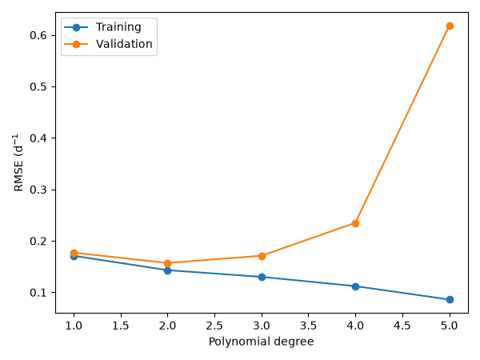
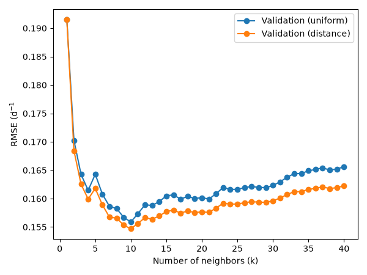
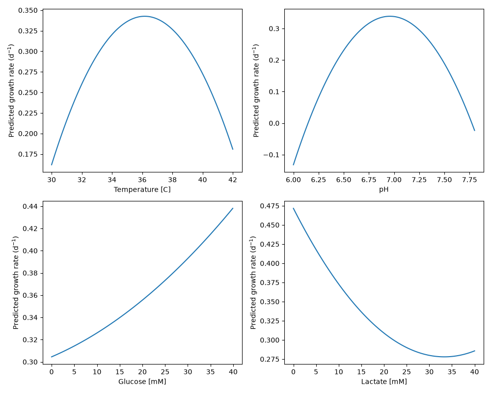

# Cell Growth Predictor

This project trains a machine learning model to predict the specific growth rate of cells from four culture conditions: temperature, pH, glucose concentration, and lactate concentration.
Predicting how fast cells grow helps estimate how long a culture will take to reach its target and helps identify the operating conditions that lead to the fastest growth.

## Highlights

- Built a scikit-learn pipeline to predict cell growth rates
- Compared polynomial and k-nearest neighbors regression models
- Tuned hyperparameters using 5-fold cross-validation with GridSearchCV
- Evaluated the final model on an unseen test set
- Visualized validation curves and variable effects with Matplotlib

## Environment

- Python 3.14.7
- matplotlib 3.11.0
- numpy 2.5.2
- pandas 3.0.5
- scikit-learn 1.9.0

## Code Design

When `main.py` is executed, the program runs a complete machine learning workflow, from loading the raw data to evaluating the final model and saving the results.
The workflow is organized into the stages below.

### Configuration

All fixed settings of the project are stored in `src/constants.py`: the dataset path, the test set size, the random seed, the number of cross-validation folds, and the hyperparameter values to test.
Keeping these values in one place makes them easy to find and change without editing the rest of the code. For example, testing more polynomial degrees only requires changing one line. Using a fixed random seed also makes the results reproducible every time `main.py` is run.

### Data Loading

The `load_data` function reads the dataset from a CSV file and separates it into two parts.
The inputs (`x`) are the four culture conditions: temperature, pH, glucose concentration, and lactate concentration.
The output (`y`) is the specific growth rate, which is the value the model learns to predict.
This separation is necessary because machine learning models in scikit-learn expect the inputs and the target to be given separately.

### Train/Test Split

The data is randomly split into a training set (80%) and a test set (20%).
The model only learns from the training set, while the test set is kept aside until the very end.
This is necessary because a model tested on data it has already seen could simply have memorized it.
Evaluating it on unseen data shows whether it can make reliable predictions for new cell cultures.

### Model Tuning

Two types of regression models are built and compared: polynomial regression and k-nearest neighbors (kNN) regression.
Each model is built as a scikit-learn pipeline. The first step of each pipeline standardizes the four inputs so that they are on the same scale.
Without this step, glucose and lactate (0 to 40 mM) would have much more influence than pH (6 to 8) simply because their values are larger.
This is especially important for kNN, which compares cultures using distances.

Each model has a setting that controls its complexity: the polynomial degree, and the number of neighbors k.
A model that is too simple misses the trend in the data, while a model that is too complex memorizes the noise.
To find the best balance, `GridSearchCV` tests every degree from 1 to 6 and every k from 1 to 40, with both uniform and distance weighting.
Each option is evaluated with 5-fold cross-validation: the training set is split into five parts, and the model is trained on four parts and validated on the fifth, five times.
The option with the lowest average validation error is selected.

### Final Evaluation

After tuning, the best polynomial model is evaluated once on the test set, which was never used during training or tuning.
Its test error (RMSE of 0.157 d⁻¹) is the same as its cross-validation error. This shows that the model did not memorize the training data and that it generalizes well to new cultures.
This step gives an honest estimate of how the model would perform in practice.

### Exporting Results

Finally, the program saves its results as files so they can be reviewed later and used as documentation.
Two tables are exported to the `tables` folder: the training and validation errors for each polynomial degree, and a comparison of the best polynomial and kNN models.
Three figures are exported to the `figures` folder: the validation curves of both models, which show how the error changes with model complexity, and the response curves, which show how each culture condition affects the predicted growth rate.
These files provide the evidence used in the analysis below.

## Analysis

### Model Selection

A polynomial regression model of degree 2 was selected. As shown in the table and validation curve below, the training error always decreases as the degree increases, but the validation error reaches its minimum at degree 2 (0.157 d⁻¹).
A degree of 1 is too simple: both its training and validation errors are high, which indicates underfitting. From degree 3 onward, the gap between the training and validation errors grows, which indicates overfitting.
At degree 6, the training error is zero while the validation error rises to 20.5 d⁻¹, meaning the model has memorized the training data.

| degree | train_rmse | valid_rmse |
|--------|------------|------------|
| 1      | 0.171      | 0.177      |
| 2      | 0.143      | 0.157      |
| 3      | 0.130      | 0.171      |
| 4      | 0.112      | 0.235      |
| 5      | 0.086      | 0.618      |
| 6      | 0.000      | 20.530     |

The best kNN model (k = 10, distance weighting) reached a similar validation error of 0.155 d⁻¹. With k = 1, the model copies the noise of a single neighbor, while large values of k average cultures that are too different.
Distance weighting performed slightly better than uniform weighting for almost every value of k, because the most similar cultures have more influence on the prediction.

| model                                    | valid_rmse |
|------------------------------------------|------------|
| Polynomial (degree = 2)                  | 0.157      |
| kNN (k = 10, distance weighting)       | 0.155      |

Since the difference between the two models (0.002 d⁻¹) is negligible, the polynomial model was preferred because it is easier to interpret.
It produces a smooth response with a clear optimum, which makes it possible to answer practical questions such as which temperature gives the fastest growth.
In contrast, kNN only averages nearby cultures and does not provide an equation that can be interpreted.

### Advantages and Limitations

The main advantage of the polynomial model is that it is simple and interpretable.
It uses a small number of coefficients, produces smooth predictions, and can represent an optimum, which matches how temperature and pH affect cell growth.
It also generalizes well, since its test error (0.157 d⁻¹) matches its validation error.

However, the model has several limitations. First, a degree-2 polynomial forces every response to be a parabola.
At the edges of the pH range (6.0 and 7.8), it predicts negative growth rates, which is not physically possible. For glucose, it predicts that growth keeps increasing, whereas real cells follow Monod kinetics and reach a maximum growth rate when the substrate is in excess.
For lactate, the curve rises slightly above 35 mM, which is an artifact of the parabola rather than real biology. Second, the data is noisy: the growth rate varies by about 0.19 d⁻¹ (standard deviation), and the model only reduces the error to 0.157 d⁻¹.
A large part of the variation is therefore not explained by these four variables. Finally, the model was trained on a limited range of conditions, so its predictions outside this range cannot be trusted.

### Effect of Each Variable

The response curves below show how the predicted growth rate changes when one variable varies while the other three are kept at their median values.

- **Temperature:** the growth rate increases with temperature up to an optimum of about 36 °C (about 0.34 d⁻¹), then decreases. At low temperatures, enzymes and metabolism slow down. At high temperatures, cells experience thermal stress. This optimum is close to the 37 °C typically used for mammalian cell cultures.
- **pH:** the growth rate also follows a bell shape, with an optimum near pH 7.0, which corresponds to physiological pH. Growth drops sharply in more acidic or more basic conditions.
- **Glucose:** the growth rate increases with glucose concentration, from about 0.30 d⁻¹ at 0 mM to 0.44 d⁻¹ at 40 mM, because glucose is the main substrate that provides energy for growth.
- **Lactate:** the growth rate decreases as lactate accumulates, from about 0.47 d⁻¹ at 0 mM to 0.28 d⁻¹ at 35 mM. Lactate is a metabolic byproduct that inhibits cell growth.

### Culture Conditions

**High specific growth rate:** the model predicts the fastest growth for cultures at around 36 °C and pH 7.0, with a high glucose concentration and a low lactate concentration. These are conditions where cells have enough substrate and are not inhibited by byproducts.

**Low specific growth rate:** growth is slowest when temperature and pH are far from their optimum (for example, below 32 °C or above 40 °C, or a pH below 6.5 or above 7.5), when glucose is depleted, and when lactate has accumulated. These conditions are typical of late-stage cultures, where the substrate has been consumed and byproducts have built up.

**Unreliable predictions:** the model should not be trusted near the edges of the measured ranges, where the parabola shape gives unrealistic results, such as negative growth rates at pH 6.0 or 7.8, or increasing growth at very high lactate concentrations. It should also not be used outside the ranges of the training data (30 to 42 °C, pH 6.0 to 7.8, 0 to 40 mM glucose and lactate), since it was never trained on those conditions.

### Applications

The model can be used in several ways in a bioprocess. First, it can help choose the best operating conditions before a culture is started, such as setting the temperature and pH close to their optimum.
Second, it can estimate how long a culture will take to reach its target cell density, which helps plan production schedules.
Third, during a culture, it can predict how a drift in pH or the accumulation of lactate will slow down growth. Operators could then react early, for example by adjusting the pH or feeding fresh medium.
Finally, it can reduce the number of laboratory experiments: different combinations of conditions can first be tested on the computer, and only the most promising ones are then tested in the lab. This saves time, materials, and cost.

### Future Improvements

The most important improvement would be to better model the effect of pH.
The current model predicts negative growth rates at the edges of the pH range, which is not realistic. This could be fixed by using a model that cannot predict values below zero, or by collecting more data at very acidic and very basic pH so that the model learns how growth behaves in these regions.
More generally, collecting more data near the edges of every range would make the predictions more reliable where they are currently the weakest. Adding other measured variables, such as dissolved oxygen or cell density, could also help explain part of the variation in growth rate that the current four variables do not capture.